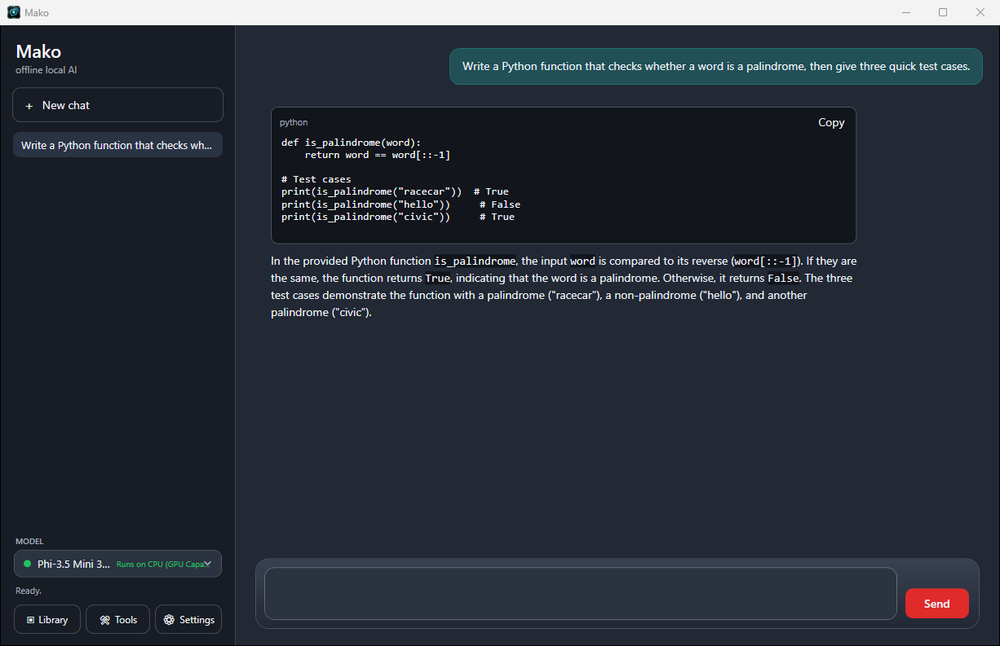

# Mako

**Mako is a private AI assistant that lives in one folder on your PC.**
Download a single `Mako.exe`, run it, and chat with a language model that runs
entirely on your own machine. No account, no install, no cloud. Your
conversations never leave the computer, and the whole thing keeps working with
the network cable unplugged.

Mako is Windows-only (Windows 10 or 11, 64-bit). It is signed by Shinra CC.

[**Download the latest Mako.exe**](https://github.com/ShinraEngineer/mako-Public/releases/latest)

*The name is a Final Fantasy VII reference: Mako is the energy Shinra draws from
the planet to power everything it builds. This Mako runs on the power already
inside your PC.*

---

## What you get

- **Local chat.** A clean desktop chat window with streaming replies, Markdown,
  tables and code blocks with a Copy button. Conversations are saved beside the
  exe and listed in a sidebar; rename them, start new ones, come back later.
- **Models that explain themselves.** A built-in Library lists chat models by
  what they are good at, for example *Qwen2.5 Coder 7B Instruct (Code-Specialized
  Model)* or *Meta Llama 3.1 8B Instruct (Reliable Long-Form Writing)*, and
  colour-codes each one for **your** PC: bright green runs perfectly, through
  amber and orange, to crimson for one that will crawl, and grey for one this
  machine cannot hold at all. The rating is recomputed every start, so the same
  folder on a laptop and on a desktop tells the truth for each.
- **GPU acceleration, optional.** One switch in Settings moves the model onto an
  NVIDIA card (CUDA) or any other modern GPU (Vulkan). CPU-only always works and
  is the default.
- **Offline knowledge.** Install Wikipedia or other Kiwix packs from the
  Library and Mako searches them for every question and cites the passages it
  used. Simple English Wikipedia is about 1 GB; the full English text-only
  edition is 49 GB.
- **Mako-Mem.** After each reply Mako notes durable facts, preferences and
  decisions and recalls the relevant ones in later chats. The memory file is
  encrypted with a passphrase you choose. Nothing is recorded until you set one.
- **Tools window.** CyberChef and IT-Tools run inside Mako with no network, and a
  Convert tab handles images, video, GIF, audio, PDF text and images, upscaling
  and ISO creation over bundled FFmpeg, ImageMagick, VTracer, Real-ESRGAN and
  poppler.
- **Chat compaction.** When a long chat slows down, Mako offers to fold the
  older messages into a short summary while keeping the recent ones verbatim.
  Nothing is deleted.
- **Portable.** Everything Mako owns sits in one `Mako-Data` folder next to the
  exe: settings, chats, models, knowledge packs, tools and encrypted logs.
  Nothing is written to AppData. Copy the two together to a USB stick or
  another PC and carry on.

---

## Getting started

1. Download `Mako.exe` from the
   [latest release](https://github.com/ShinraEngineer/mako-Public/releases/latest)
   and put it in a folder of its own, for example `C:\Mako\` or a USB drive.
   The file is about 1.2 GB because the model runtime and two models are built
   in.
2. Run it. Windows SmartScreen warns once about a downloaded exe from a small
   publisher. Choose **More info**, then **Run anyway**. Updates installed from
   inside Mako are not screened.
3. On first start Mako creates `Mako-Data` beside itself, unpacks the built-in
   CPU runtime and the Qwen2.5 1.5B chat model, and is ready to chat within a
   few seconds, with no network.
4. If you are online, Mako fetches Phi-3.5 Mini (2.3 GB, the recommended
   all-round model) in the background and switches to it when it lands. You can
   cancel that from the Library or turn it off in Settings.
5. Open the **Library** to add larger models, knowledge packs, the GPU runtime
   or the tool suites. Everything downloads into `Mako-Data` and is
   hash-verified.

To remove Mako, delete `Mako.exe` and the `Mako-Data` folder. There is nothing
else.

### What runs on what

| Your PC | What to expect |
|---|---|
| 8 GB RAM, no GPU | The built-in 1.5B model and the 3B models run well. Phi-3.5 Mini runs but takes its time. |
| 16 GB RAM, no GPU | Up to 7B and 8B models at a readable pace. |
| 32 GB RAM or more | 12B and 14B models on the CPU. |
| Any of the above plus a GPU with 6 GB or more | Models that fit in video memory run several times faster. Turn on **Hardware Acceleration** in Settings. |

The Library colours do this maths for you, and hovering a chip shows the
numbers behind the rating and what to change.

---

## Privacy

- Chat, memory, knowledge search and the tools all run on your machine. There
  is no telemetry and no account.
- Mako only talks to the internet in three cases: downloads you start from the
  Library (plus the one-time Phi-3.5 fetch, which you can turn off), a check
  of this repository's latest release for updates, and the Kiwix pack catalog
  when you open Library > Knowledge, so it can list the packs available.
  Offline, all three fail silently and nothing else changes.
- Mako-Mem is sealed with AES-256-GCM under a key derived from your passphrase.
  The passphrase is never stored, so a copied folder carries ciphertext only.
- Logs are encrypted per machine. Settings > **Export logs** writes plain
  copies when you need to troubleshoot.

---

## Updates

Mako checks this repository for a newer signed release when it starts and
every half hour, and shows an **Update ready** button in the sidebar when one
exists. Pressing it shows the notes and offers **Install and restart**. The
download must match the published SHA-256 and carry the same Shinra CC
signature as the running exe before it replaces anything.

Every release here is tagged `vN` and carries `Mako.exe` and `mako-update.json`
(version, size and SHA-256). Release notes live in [CHANGELOG.md](CHANGELOG.md).

---

## About this repository

This repository holds the signed releases and their notes. Mako's source code is
kept in a private repository. Bug reports and questions are welcome in
[Issues](https://github.com/ShinraEngineer/mako-Public/issues).

Mako is built on [llamafile](https://github.com/mozilla-ai/llamafile) by
Mozilla, [kiwix-tools](https://github.com/kiwix/kiwix-tools),
[CyberChef](https://github.com/gchq/CyberChef),
[IT-Tools](https://github.com/CorentinTh/it-tools), FFmpeg, ImageMagick,
VTracer, Real-ESRGAN and poppler. Models come from their publishers on Hugging
Face under the licences shown on each Library row.
